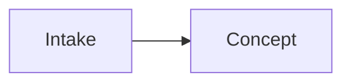

# Conventions — the human↔Claude contract

This file defines **how every note in this vault is written**, so the design is equally readable by a human in Obsidian and by Claude as plain text. Follow it and Claude can reconstruct the whole system from the files alone.

## 1. Every note starts with frontmatter

```yaml
---
title: Human readable title
type: charter | strategy | engine | architecture | data | platform | operations | flow | adr | glossary | meta
status: draft | accepted | implemented | deprecated
updated: YYYY-MM-DD
tags: []
related: ["[[Other Note]]"]   # wikilinks to connected notes
---
```

- `type` tells Claude what kind of content to expect and which template applies.
- `status` tells Claude how much to trust it. `draft` = written, but the human has not ruled on it — a proposal, never a decision. `accepted` = decided. `implemented` = exists in the code. `deprecated` = ignore unless doing history.
- `updated` is the last-edited date, always `YYYY-MM-DD`. Bump it when you change the note.
- `related` is the explicit graph — the notes this one depends on or references.

### `type: platform` carries two extra fields — and they are mandatory

```yaml
verified: YYYY-MM-DD          # the day a human or Claude last checked this against the source
sources: ["https://…"]        # where each claim came from
```

**This is the one field this vault adds beyond the parent standard, and it exists for a specific reason.** Platform facts — API pricing, posting quotas, policy, audit gates — are the only claims here that can become false *without anyone touching the note*. Every other kind of drift in this vault is caused by an edit. Platform drift is caused by the calendar.

An undated platform claim is worse than no claim, because it is trusted. `check-vault.mjs` fails on a `type: platform` note missing either field and warns when `verified` goes stale.

## 2. Two kinds of document, and the difference is absolute

This is the spine of the whole standard. Every note in this vault is one or the other.

| | **Decisions** (`Decisions/`, `type: adr`) | **Living notes** (everything else) |
|---|---|---|
| Mutability | **Immutable once `accepted`** | Edited in place, freely |
| Changing it | Write a **new ADR that supersedes it** | Edit the note, bump `updated:` |
| Answers | *Why* a load-bearing decision was made, and what it holds in place | *What* the system currently is |
| Recreating it | Never | Never — edit it, don't rewrite it from scratch |

**Both are sources of truth, and a living note is as authoritative as an ADR.** Most of the design lives only in living notes, as plain present-tense fact, and needs no ADR to be binding. A living note describes the world **as it is now**. An ADR describes **a load-bearing choice made on a date**, and stays true forever because it is a record of that moment, not of the present.

When the two disagree, the ADR is what was decided and the living note is what is — which means either the living note is stale, or a load-bearing decision was changed without a superseding ADR. Both are defects. Surface them; do not pick a winner silently.

## 3. Only load-bearing decisions become ADRs

**An ADR solidifies a decision the system as a whole depends on.** The test: *if someone changed this later, would data become wrong, or would other parts of the design break?* Yes → it is a candidate ADR. No → it is a sentence in the living note that owns it, and nothing more.

**Not ADRs**, however important or hard-won: a definition · a preference · a naming choice · a choice that is merely non-trivial or non-obvious · a rule only one living note depends on. Each of these is written as present-tense fact in its living note, with its reasoning beside it where the reasoning matters.

**Why the bar is this high.** An ADR restates part of a living note, so every ADR is a second copy of a fact (§8). That copy earns its cost only when the fact holds other parts of the design together — where the immutable record of *why* protects more than it costs to keep in step. An ADR written as a guardrail for a single note is pure drift surface.

To write one: copy `_templates/ADR.md` into `Decisions/`, next zero-padded number, never renumbered. The living note that *uses* the decision links to the ADR — `check-vault.mjs` fails on an accepted ADR that no living note links to, because an ADR reachable only from the file system puts its *why* in front of nobody.

**An accepted ADR is immutable.** To change one, write a new ADR that supersedes it; never rewrite an accepted body. Three narrow exceptions:

- **A rename may repoint an ADR's links — nothing else may be touched.** A link target is not content.
- **When an ADR's text has gone stale, *where* the stale text sits decides how to fix it.** Stale text inside **Decision** gets a dated banner on the ADR body, because it misleads about what was decided. Stale text in **Consequences** — an aside about a neighbouring concern the ADR explicitly declined to decide — gets a note on its **[[_ADR Index]] row instead**, body untouched. Choosing banner-vs-index-note by *where the text sits* is the reusable half of this rule.
- **A same-session amendment, made before anything depends on the original wording,** may be applied in place **provided the original text is preserved alongside it** — which is the purpose immutability serves.

**Never cite anything impermanent from an ADR body** — see §6.

### An ADR records a decision the human made

Claude proposes; the human decides; then it is written. **Claude must never author an ADR for a choice the human has not actually made**, and must never present its own reasoning in a form that reads as settled record.

**Claude never sets `status: accepted`.** Every ADR Claude writes is created as `status: draft` and stays there. Claude then tells the human the draft is ready and states plainly what it decides. The human reviews it and rules on it. Only that instruction changes the status — never Claude's own judgment that the draft is sound.

A draft ADR is a proposal that happens to live in a file. It is not a decision: it gets **no row in [[_ADR Index]]**, and no living note may cite it as settled. `_meta/check-vault.mjs` lists every draft on every run, so one cannot sit unread and quietly become the parking lot this vault refuses to keep (§6).

Formatting a proposal as a ratified record launders opinion into permanence, and nothing downstream can tell the difference afterward — the log says *decided*, and the reader has no way to learn otherwise.

**An open choice is not written to the vault at all.** It stays in conversation until the human decides it, and only the decision is recorded. This vault keeps **no register of the undecided** — no parking lot, no open-questions note, no backlog of things to settle later. Such a register is a handoff document wearing a different name (§6): it is accurate the day it is written, nothing goes back to retire a row once the question is answered in passing, and an agent reading it proposes work the human already resolved.

**The one case that looks like an exception, and is not.** A choice the human has *deliberately deferred* — "we are not deciding storage until the ingest path is proven" — is itself a decision, with a rationale and a trigger condition. **If the deferred choice is load-bearing**, it gets an **ADR**, `status: accepted`, stating what is deferred and what would end the deferral. That is strictly better than a parking-lot row: it carries the *why*, it is immutable, and the ADR that later settles the question supersedes it in the normal way. **If it is not load-bearing, it does not enter the vault at all** — it goes to the tracking project as a deferred item (§10), with what would reopen it, and the living note says what the system *is* without naming what it lacks (§6.1).

## 4. All diagrams are Mermaid — no images

Never paste screenshots or binary diagram files. **Nor a drawing in any other wrapper** — the ban is on the *content*, not the file format: a scene stored as JSON inside a Markdown file is still a drawing. Diagrams live in fenced blocks:

````

````

This renders in Obsidian **and** is plain text Claude reads losslessly. Diagram type by purpose:

| Purpose | Mermaid type |
|---|---|
| System structure (context, containers, modules) | `flowchart` with `subgraph`s |
| Entity / data model | `erDiagram` |
| A journey or a pipeline pass | `sequenceDiagram` |
| Lifecycle / status machine (e.g. a content item's states) | `stateDiagram-v2` |
| Process / decision logic (e.g. an approval gate) | `flowchart` |

### Data-model granularity — model the concept, not the schema

Wherever this vault's ER diagram lives, it is the **conceptual** model. Physical columns live in the codebase and its schema definitions, never duplicated into the diagram, or they drift. Per entity show only: `id`; the **discriminators/enums that drive behavior** (`status`, `kind`, and whatever else branches the logic); one to three defining attributes; and relationship-bearing FKs where they carry meaning. Omit timestamps unless semantically load-bearing, derived columns, physical types, and indexes.

## 5. Naming & structure

- **Folders are named, never numbered, and exactly one level deep.** No subdirectories anywhere. Numbering implies a reading sequence that folder names do not carry.
- **[[_meta/manifest|The manifest]] carries the reading order.** That is the one place a sequence belongs.
- Index/aggregator notes are prefixed `_` (e.g. `_ADR Index`).
- ADRs: `ADR-NNNN - short title.md`, zero-padded, never renumbered.
- One concept per note. Link generously with `[[wikilinks]]`.

## 6. Nothing transient lives in this vault

**This vault houses the design, and only the design.** A document that belongs here is **true indefinitely** — the architecture, the data model, the system's components, the decisions, the platform constraints. A document describing *what we are doing this week* does not belong here at any size.

**Banned outright, in every folder, under any filename:** handoffs · build plans · phase plans · roadmaps · checklists · to-do lists · session notes · progress snapshots · "current state" briefs · **open-questions notes · parking lots · backlogs** · scratch files · anything named `TEMP`/`WIP`/`DRAFT-`/`HANDOFF`. **Claude must not create one here, ever, for any reason** — not even as a convenience it intends to delete later. `check-vault.mjs` check 7 fails on these filenames.

**A register of the undecided is a handoff in disguise,** which is why it sits in that list. It reads as a live agenda and behaves as a stale one: a question answered in passing leaves its row standing, because nothing goes back to retire it, and the next agent proposes work the human settled a month ago. A session exists to answer open questions; the answer becomes an ADR or a living-note edit, and the question itself was never the asset.

**Where they go instead:**

| What it is | Where it lives |
|---|---|
| Agent scratch work, intermediate output, one-off scripts | the agent's **own scratch directory** — never the vault |
| Where the build stands; what ships next; which phase anything is in | the **tracking project** (§10) — never a note, never the vault's own issues |
| An open choice, an option, a recommendation | **conversation** — until the human decides it, then an ADR (§3) |
| A choice deliberately left open | an **ADR** naming what is deferred and what would end the deferral, if load-bearing; otherwise a **deferred item on the tracking project**, with what would reopen it (§3, §10) |
| A rule the code cannot satisfy, or two rules that collide | a **conflict item on the tracking project**, opened with a person's approval and blocking the build until a person rules (§10) |
| A durable outcome that came *out of* transient work | folded into the **living note** it belongs to, or an **ADR** |

**The reasoning.** A transient note is accurate the day it is written and progressively false afterward — and because nothing goes back to retire it, it becomes a **second source of truth that disagrees with the first**. It is read as current: a stale plan carrying a false ✅ retires work that still has to be done, and a fresh agent cannot tell. Every such file is also permanent drift-check surface and permanent `/sync` cost.

**Corollaries:**

- **Never link from an ADR body to anything impermanent.** An accepted ADR is immutable (§3), so a pointer from one **pins its target in place permanently.** If an ADR must reference the *circumstances* of a decision — a plan, a conversation — it states them in its own words.
- **A dated record may name a deleted document; it may not link to one.**
- **If transient work produces something durable, land it in the living note before the work ends.** The handoff is not the deliverable; the updated design is.

### 6.1 A document never describes its own maturity

**No note states how complete it is, how new the vault is, what it is missing, or what a future reader should do about any of that.** This is §6's ban hiding inside a permanent document: the sentence is true the day it is written, false afterward, and nothing ever goes back to retire it.

The test is mechanical: **a line that is guaranteed to need overwriting is drift surface by construction — and if it is *not* overwritten, the drift shipped silently.** A line that can only be right on one day has no business in a document meant to be true on all of them.

**Banned, in every note including this one:**

| Banned | Why |
|---|---|
| "the vault was initialized on ⟨date⟩", "design not started", "barely started" | a status snapshot, stale the moment work continues |
| "currently empty", "near-empty", "still small", "no notes yet" | describes a moment, not the subject |
| "not yet written", "does not exist yet", "none yet", "so far", "for now", "at present" | announces an absence that the indexes already show |
| "as the vault grows", "once folders carry content", "re-measure this later", "this will change when" | an instruction to a future editor, i.e. a to-do list of one |
| "at the time of writing" | concedes the sentence has an expiry date |

**Write what is, not what is missing.** An absent note needs no announcement — the folder map, the indexes and `_meta/check-vault.mjs` already report what exists, and unlike prose they cannot silently disagree with the files.

**The narrow exception: a current-state claim a script enforces.** A statement about right now is permitted *only* when `_meta/check-vault.mjs` fails the moment it disagrees with the files on disk. That is the whole standard — **a current-state claim is allowed when, and only when, the guard makes drift impossible.** If you want to state a count, add the check in the same pass (§8); if you cannot check it, do not state it.

**Prefer deriving to stating.** Meeting that bar is not a reason to clear it. A written count earns its drift surface only when something reads the number *instead of* the files — and `/sync` reads every file, every session, so a count in a note tells an agent what it just finished counting. It also costs one drift site per place it appears, plus the check that polices them, plus the re-anchoring that check needs every time the line is reworded. **Derive it; do not write it down.**

**This bans `> [!todo]` too, and every callout that does the same job under another name.** A todo naming a gap in the design looks like the permitted kind of sentence — *"the retry path is unspecified"* is true until the system changes — but it behaves like the banned kind: it is a to-do list of one, sitting in a document that is meant to be true on every day, and nothing goes back to retire it when the question is answered in passing. **A note says what the system is; it never names what the system lacks.** A gap worth remembering goes to the tracking project as a deferred item, with what would reopen it (§3, §10). `check-vault.mjs` check 12 fails on any `[!todo]` in a note.

**Corollary for the reading order.** The manifest carries sequence, not progress. It lists what to read, never how far along the vault is.

## 7. No visual design lives in this vault

The vault carries the **verbal** half of design and none of the visual half. Mermaid (§4) is the sole exception, and only because a Mermaid diagram is a *structural* statement in text, never an appearance.

**Never in the vault:** mockups · wireframes · comps · drawings · screenshots · canvas scenes · rendered output · example artifacts as images · anything whose purpose is to show *what something looks like*.

**Wherever a design has a visual half, the line is worth stating precisely.** The distinction is always the same — the contract belongs here, the artifact does not:

| Verbal / technical — **belongs here** | Visual — **belongs outside** |
|---|---|
| Design tokens as **values**: hex codes, font names, a spacing scale | A rendered comp, a moodboard, a logo file |
| A format's **contract** — dimensions, duration, required elements, placement rules | A finished artifact that satisfies it |
| A **voice** or **style** specification and its written examples | A screenshot of something that reads or looks right |
| A production pipeline's inputs, stages and outputs | The artifacts it produced |

**Planning production and its technical requirements is correct work for this vault. Producing or storing the output is not.** Rendered artifacts live in the code repo or object storage; this vault describes how they are made and what they must satisfy.

## 8. How Claude should treat this vault

- **Source of truth = these files.** If memory and the vault disagree, the vault wins — and say so out loud.
- **The vault's subject is stated exactly once — in the [[Project Charter]].** The project's name, what it does, who it is for and what domain it lives in are written there and referred to everywhere else. ⚠ **Never restate them in another note**, however convenient: a subject described in two notes is a subject that gets corrected in one, and the reader cannot tell which copy is current. Link, do not repeat.
- Before recommending changes, read the `related` graph of the affected note.
- Keep [[_meta/manifest|the manifest]] current when adding, removing or renaming a note.
- **Surface conflicts; do not silently fix them.** Report and let the human decide.
- **A rule and its mechanism are written together** — see §9. Read a note's **Mechanism** boxes as design: they say how a rule is to be carried out, and they are the target whenever the code differs.
- **A fact stated twice and corrected once is this standard's signature defect.** When a decision changes a field, a name or a rule, grep that term across **every** folder and fix all of it in one pass. ⚠ **A half-applied ripple is the most dangerous kind, because the note looks updated** — it carries the correction *and* an uncorrected copy, so the next reader trusts it. **When a countable fact can be checked by a script, add the check to `_meta/check-vault.mjs` in the same pass** instead of fixing the instance again.

## 9. Rules and mechanisms live together

**This vault exists to be read beside the code, by an agent that is about to change it.** A note that states a rule and leaves the mechanism unsaid invites that agent to invent one. So every living note carries both: **the rule in plain words, and directly under it, the mechanism that carries the rule out.**

**The rule is ordinary prose. The mechanism is a callout, placed immediately beneath the rule it serves:**

````
**The search index follows.** It is written after the order and catches up.

> [!abstract] Mechanism
> The order is in the database and the index is in the search service. One
> transaction cannot cover two systems, which is why …
````

A person follows the design by reading the prose and may skip every box. An agent reads both. **A change to a rule puts its mechanism in front of the editor, and an addition has one obvious place to go** — which is the whole reason the two are not kept in separate notes.

**A Mechanism box is design, never a report on the code.** It says how the rule *is to be* carried out: the software, the named job, table or module, how it works, and what must not be broken. It is equally true before the code exists and after. Where the code differs, the box is the target and the code is what changes. Whether something has been built is a claim about the repository and is never written here (§6) — `check-vault.mjs` check 13 fails on a note that makes one.

**The vault decides the large-scale design; it does not describe every line of code.** Code doing something no rule mentions is neither drift nor a defect. Code that contradicts a rule is, and §10.2 says how it is handled.

Four rules keep this from becoming a second copy of anything:

1. **A fact has one home; a name can appear anywhere.** Any note may name a database. *"The orders live in that database"* is stated in exactly one — the note that owns the orders. **One note lists each piece of software once**, with what it is for and the note that owns its use; it is written with the first Mechanism box that names a piece of software, and is the answer to *"what do we use for that?"*
2. **The vault holds the rule and the mechanism; the repository holds the code.** A box names software, jobs, tables and modules, and describes how they behave. **It never holds code, a column list, or a file path** — those go stale the moment a file is renamed, and physical columns are already kept out by §4. Modules are named the way the repository names them, and nothing finer.
3. **A note that grows too long splits by subject — never into a conceptual note and a technical one.** That split is exactly what gives one fact two homes.
4. **An ADR states the rule and the reason; the mechanism stays in the living note.** An accepted ADR cannot be edited (§3) and mechanisms change. *"A balance is read and written as one act"* survives a change of locking strategy; the name of the lock would not.

**Give the mechanism room.** A diagram per flow, the named steps in order, what is written together and what follows, what happens on failure. Detail that an agent would otherwise have to guess is detail that belongs in the box.

## 10. The build is tracked outside the vault, and the line is absolute

**The vault says what the system is. One GitHub Project, spanning this repository and the code repository, says what is being done about it** — which build items exist, what phase each is in, which are blocked on a design question, and which choices have been deliberately deferred. That project is the register of the undecided this vault refuses to keep (§3, §6), and it is where such a register belongs: an item there is *meant* to go stale the day it is done, because closing it is the act that retires it. A note has no such act, which is the whole reason §6 exists.

**Which project, which repositories and which commands are this vault's is written once, in `.claude/workflow.json`** — the code repository, the board's title, the commands the gate runs, and whether the product has been deployed to production. Every skill, the guard and the hook read it from there; no rule in this section names a repository, and `check-vault.mjs` fails while a field in it is unfilled, exactly as it does for the [[Project Charter]].

Seven rules keep the two from bleeding into each other:

1. **An item links to a rule; it never restates one.** A build item names the living note and section that govern it, by a link to the file on this repository's main branch, carried in the board's **`Rule`** field — a living note is edited in place, so the current text is always the governing one. **The link names what governs the item, never what the item changes**: most work applies rules and alters none. An item that quotes a Mechanism box is a second copy of the design (§8), relocated, and it drifts the same way.
2. **A note never names an item.** No living note links to an issue, a pull request or the project. A conflict is resolved by editing the note or accepting an ADR, and the item is closed once that is done — the note carries the answer and never the question. `check-vault.mjs` check 14 fails on any such link.
3. **A rule the code cannot satisfy, or two rules that collide, is a conflict item**, raised against this repository and marked as blocking every build item that waits on it — the relationship is set on the issues themselves, and the board's status follows from it. Nothing works around a rule: the moment a conflict is found the work stops, and it stays stopped until a person rules. Resolving it is a living-note edit or an ADR, and a person closes the item once that resolution is made — never before.
4. **A deferred choice that is not load-bearing is a deferred item**, naming what was deferred and what would reopen it (§3). A load-bearing deferral is an ADR, as before.
5. **No item is opened anywhere without a person's approval** — a draft on the board included. An agent that finds a conflict, proposes deferring a choice, or plans a phase, says so and stops; it opens the item only once a person has said to. An issue is a claim on the owner's attention and on other people's work, and the act that makes it is theirs. ⚠ **Until the product is first deployed to production, this is suspended for an agent working an item marked *Agent* (§10.4):** it opens a conflict, a deferral or a codebase problem as it finds one, and each appears on that phase's sign-off sheet. The approval returns with the deployment, which `deployedToProduction` in the workflow file records. **Closing is split, and what the close asserts is what decides whose act it is.** A build item closed says one unit of work was finished and verified — a claim about the code, which a check can establish — so the agent that merged it closes it (§10.3). **A conflict or a deferral closed says a person has ruled**, and no check stands in for that. **A phase closed says the work is live**, and that is a person's too (§10.2).
6. **A build item applies rules that already exist; it never settles one.** It is one unit of work a subagent can finish and report in a single pass — larger than that is split before it is opened — and everything it must obey is already written. **An item that cannot name the rule that governs it is not a build item but a design question**, and it goes to the vault first (§3): the rule is settled as a living-note edit or an ADR, and only then is the item opened. **Most work changes no rule at all**, and the vault is read for permission far more often than it is rewritten.
7. **A phase is a milestone, and it is planned rather than invented.** **Work is planned by system** — each part of the design that works as one — **and each milestone is one step that makes one system whole**: it ends with that system working as one, and runs for as many sessions as that takes. A milestone may instead bridge two systems where its work is the seam between them, and it then names both. Milestones are planned in conversation against the vault, ahead of when they run, and recorded in the code repository — one per phase; **a milestone's items are written when that milestone comes up**, against the vault as it then stands, rather than all at once. A milestone belongs to a repository, so the vault's own issues carry none: neither a conflict nor a deferral is phase work. **A phase is never written into a note**, and how one is branched and how one is stopped is §10.2.

**An item is opened complete.** Every field the board carries that an agent can set is set in the act of opening it — who it is assigned to, its status, its labels, its type, its priority, its milestone, the rule that governs it, and whether an agent or a person finishes it. **A field left empty is a question the next session has to answer by guessing**, and the board is the only place it could have been answered: an item with no `Finished by` does not say whether it stops for a person, one with no priority does not say what to take before it, and one assigned to nobody does not say it is already being worked.

**Two fields may be empty, and only for the reason that makes them so.** An item that is a problem in the codebase rather than a build item carries no `Rule`, because no rule governs it (§10.1); an item that is not phase work carries no milestone, because a milestone is a phase (rule 7). **Every other empty field means the item was not finished being opened**, and an item in that state is worse than no item: it occupies the register, reads as tracked, and tells the next agent nothing about what taking it would mean.

What may be said where:

| | In the vault | On the project |
|---|---|---|
| What the system is | the living notes | a link to them |
| Why a load-bearing choice was made | an ADR | a link to it |
| What is being built, and in what phase | never | a build item and its milestone — one milestone per phase |
| What is undecided | never | a conflict or deferred item |
| Whether something is built | never (§9) | an item closed — and *Live*, once its phase merged (§10.2) |

The two kinds of item this repository raises — a conflict and a deferral — are Markdown issue templates in its `.github/` folder, so an agent opening one from the command line is handed the same headings a person is handed in the browser. They are repository tooling, not notes: they carry no `type:` or `status:` and sit outside the folder map, exactly as `.gitignore` does.

### 10.1 Every agent starts here, and the code is built from here

**This repository is the only place an agent is initialized.** The code repository carries no agent configuration — no skills, no settings, no rulebook — so there is no second set of rules for a second starting point to drift from. **It carries exactly one instruction file, and that file is a tripwire, not a rulebook:** it tells an agent that was started there to stop, names this repository as the place to start, and states the one test a subagent sent from here can pass — that it was handed a build item from the project by a session started in this vault. It restates no rule and names nothing that changes, which is what keeps it from drifting. What the code repository says about itself beyond that, it says in its own `README`, for a person and an agent alike: how to install, run and test it. The code is reached from a session started here as a second working directory, declared in the agent's local, uncommitted settings, never in anything this repository tracks.

**`/sync` is the one act that brings an agent up to speed, and nothing is done before it.** It loads the whole vault, runs the guard, and reviews the project: the conflicts the build is stopped on, the items blocked behind them, the build items free to take, and whether the board is empty — in which case the next phase is planned in conversation and becomes items with a person's approval. A project review without the vault loaded first would be reading items whose rules the agent has not read, which is why the two are one pass and not two commands.

**Three roles, and the session started here is the first.**

| Role | Is | Owns |
|---|---|---|
| **The milestone manager** | the session started here, running the `/milestone` skill | one milestone end to end — the order of its issues, handing each out, merging each verified issue into the milestone branch, verifying the phase whole, and the sign-off sheet (§10.3). It stops at the pull request into the main branch |
| **The issue manager** | a subagent, defined once in this repository's `.claude/agents/` | **one issue and nothing else** — its branch, its build, its commits, its pull request, and the fixes its verification asks for. It never merges, and never touches another issue |
| **The verifier** | a subagent, defined beside it | checking one issue, or one milestone, against the rules that govern it (§10.3). It never builds and never merges |

**One milestone manager per milestone, and one per session.** A milestone is never shared between two managers, and a session manages one milestone.

**A session takes at most ten issues, then hands over.** Context grows with every issue, and so does what each step costs. Once a manager has taken ten issues to a merge or a park, it finishes nothing new: it writes a handoff to a **local file outside both repositories** — where the milestone stands, what is in flight, every fork and finding not yet on the sheet — tells the person a context refresh is due, and stops. A fresh session runs `/sync`, resumes the milestone from that file, and deletes it. **The handoff is the one transient document this workflow writes, and it never enters the vault or either repository** (§6).

**An issue that belongs to no milestone is run the same way**, as a milestone of one whose parent branch is the main branch.

**The milestone manager hands over the rules themselves — the governing sections in their own words — and never a path to go and read them**; the issue manager builds in the code directory and reports back, and the pull request that results names the issue it answers and the commit of this repository it was built against — the one record of which design the code answers to. **It is then verified by an agent that did not build it, and it merges only on a pass** (§10.3). **The milestone branch it merged into is a person's to merge**, and that is what says the work is live (§10.2). **Neither subagent ever writes to this repository.**

**Only the milestone manager reads this repository.** A subagent is handed what governs its item and does not open the vault — it has no business in it, and the manager has already read the whole thing. A subagent reading it again is the same work done twice by the party that has read less of it, and it is time paid on every item of every phase.

⚠ **What is handed over is each section's own words, never a summary of them.** That form is the price of the rule: **a rule the manager paraphrased is a rule the manager may have changed**, and a subagent that cannot open the vault cannot catch it — the builder and the verifier are then wrong in the same way, and nothing downstream notices. **So a misread rule is the manager's**, and it sits in one place — what was handed over — rather than in what an agent might have looked up.

**An issue that follows on from earlier work names the closed issues it follows, and the manager reads them and their pull requests before handing it out**, so the issue manager starts from what its predecessors built, where it lives and why. That history is the issue manager's to be given and never the verifier's (§10.3).

**A subagent that has not been given what it needs asks for it, and does not proceed on a guess.** The gap is the manager's to close, and one question costs less than an item built against a rule nobody quoted.

**The manager hands over the method as well as the standard.** *Prove this holds* is an instruction a coder answers by inventing whatever machinery reaches it. Where evidence takes a particular shape — a number of runs, a reproduction before a fix, a measurement rather than an assertion — the manager says how it is obtained, because the alternative is a subagent building something nobody asked for in order to satisfy a sentence.

**An issue manager creates nothing outside its own issue's branch, and a verifier creates nothing outside the branch it is checking.** Not a second branch, not a tag, not a scheduled run, and no issue — what it finds outside its issue it reports to the milestone manager, which decides what becomes of it (§10.5). Everything it makes sits on the one branch, so abandoning an issue leaves nothing behind to find.

**Three kinds of problem, three destinations, and none is a note.** A rule the code cannot satisfy is a **conflict** (rule 3): the item stops, the manager surfaces it, and it is resolved here, by a person. A problem in the codebase itself — a failing test, a broken build, a mistake in earlier code, a dependency that will not install — is the code repository's: it is fixed where it is found when the issue's own checks need it, and otherwise raised as an issue *in the code repository* by the milestone manager (§10.5). **A codebase problem never enters the vault, and a vault rule never bends to one.** The rules here are absolute; where the code cannot meet them, the code is what changes, or the conflict is raised and a person decides.

⚠ **A cause is a hypothesis until something establishes it, and it is written down as one.** A stack trace, a log line and a failing check say what happened; what is *responsible* is a claim, and a plausible reading of a symptom is the commonest way a phase spends an item on the wrong thing. So a problem raised before its cause is known **describes the symptom and the evidence** — what fails, how often, and what rules out the innocent explanations — and names a suspected cause as suspected, or not at all. **An unestablished cause written as fact is worse than none**, because the next reader builds against it, and the record then has to be corrected by whoever notices.

**The third is neither, and it is the commonest: a case no rule reaches.** The design is silent rather than wrong — nothing collides and nothing is unsatisfiable, the question simply was not asked when the note was written. **On an issue an agent finishes, a reversible answer is decided on the best reading, recorded, and carried on (§10.4); only an irreversible one waits for a person.** On an issue a person finishes, the person is asked: the work stops where it stands, the milestone manager puts the question to them with what it has already read, and the answer is built. Either way, where the answer turns out to be a rule rather than a one-off, it is written into the living note that owns it first (rule 6). No issue is opened, because there is nothing to record — silence is not a defect. ⚠ **This is the exit an agent will reach for least and need most**, and guessing here is how an unmade decision reaches the code looking like a made one. **The build was never meant to keep a person out of it.** It exists so that when one is asked, the question is small, specific, and already researched.

**Why the line is absolute.** A design vault that tracks its own build fills with documents that are true on one day and retired on none — handoffs, phase plans, to-do lists beside the design — until the design cannot be read through them. The project is not a convenience beside the vault; it is the second place that keeps the first one honest, and it only does that while nothing crosses the line in either direction.

### 10.2 A phase, its branches, and how one is stopped

**Two kinds of branch exist in the code repository, and nothing else does.**

| Branch | Made from | Merges into | How, and by whom |
|---|---|---|---|
| **A milestone branch** | the main branch | the main branch | a merge commit, **by a person and only a person** |
| **An issue branch** | its milestone's branch — or the main branch, for an issue that belongs to no milestone | the branch it was made from | a **squash**, by the milestone manager once its verification passes — or by a person, where the parent is the main branch |

**Every issue gets a branch, however small**, because an issue needs somewhere its verification can fail without touching anything shared. **No other branch is made** — not one to verify on, not one to fix on, not one for a chore. Verification runs on the branch being verified: an issue's on its issue branch, a phase's on its milestone branch (§10.3).

**An issue branch carries as many commits as the work needs; its parent gains one.** The squash is what turns an issue's whole history — its build, its rounds of verification, its fixes — into a single commit on the milestone branch, titled with the issue's number and title and naming the commit of this repository it was built against. **The main branch therefore reads one commit per issue and one merge per milestone**, which is what a person signing a phase off can actually read.

**The issues of a phase are ordered by what it costs to check them, cheapest first**, unless one genuinely depends on another. An issue whose verification runs a whole suite several times is the slowest thing in a phase and belongs late in it, however tempting its subject makes it as a starting point — and **an issue that unlocks something for the others unlocks it only once it has merged**, so putting it first buys the cost and none of the benefit. **Something merges early, or the order is wrong**: a phase in which nothing has landed is a phase whose shape nobody can see.

**A milestone grows by anything its system needs to be whole.** Work found part-way through that the system needs is opened as an issue of this milestone and ordered where it belongs; where an issue manager cannot finish its issue until something outside it is fixed, that something is ordered first (§10.5). **Work that belongs to another system stays out** — it is opened as an issue of its own, outside the milestone, and listed on the sign-off sheet.

**Work found after a milestone has merged never joins it.** A merged milestone is a shipped one, and its sign-off sheet is the record of what was signed. The work runs as an issue of its own where it is small — a milestone of one — or as a new milestone of the same system, linked to what it follows (§10.1).

**A milestone ships everything its system's work needs, in the same pass:** its interfaces, the observability the vault names for it, and anything a person sees of it — and its verifier checks them together, while the code they cover is the code being changed. Only machinery built once for every system is foundation work of its own.

**The order of milestones is kept on the project, as each milestone's due date.** A milestone has no start date of its own: it starts when the one before it is due. A due date marks a place in the sequence rather than a promise, and **the milestone manager keeps it accurate** — when it writes its milestone's issues, when the milestone runs past its date, and when it finishes. Each time, it moves its own date and every later milestone's by the same amount, earlier or later, so the chain keeps its spacing and its order. **Re-dating never reorders milestones**; changing the order is a person's planning decision (rule 7). Every re-date is recorded on the sign-off sheet (§10.3), and `/sync` reports any open milestone whose date has passed.

**No separate pass reconciles the code with the vault.** Code that contradicts a rule is fixed by the milestone whose system it belongs to, when that milestone runs. That is no licence to pass one by: an agent that meets a contradiction no issue covers reports it, and it is opened as a codebase problem (§10.5).

⚠ **On a branched phase, *Done* means squash-merged into the milestone branch and nothing more.** The issue's work is finished and verified (§10.3); it is not live. **The milestone branch merging is what says shipped** — a person's act, signed off from the sheet (§10.3), and the milestone closes with it.

**The branch rules are held by the repository, not by agents remembering them.** The code repository's own rules refuse a branch whose name is neither kind, accept only a squash into a milestone branch, and accept only a merge commit into the main branch; a hook in this repository's agent settings refuses any agent's merge into, or push to, the code repository's main branch, because the repository cannot tell an agent from the person whose account it runs on; and `/sync` reports any branch of neither kind and any issue that reached its parent as more than one commit.

**An item is *Live* from that moment, and the status is derived rather than set.** It follows from the phase branch having reached the main branch, so nothing judges it and nobody marks it by hand. An item reading *Live* against a phase nobody merged is the one way this misleads, which is why `/sync` reconciles it against the branch instead of trusting the board. Anything asking what is in production may read either the item or its milestone, because the item's answer is the milestone's. **An item outside a phase — a milestone of one, or an issue of this repository — is *Live* once the change that resolved it is on its repository's main branch**; for a conflict or a deferral, that is the vault edit that answered it. The board's own automation marks a closed item *Done*, so `/sync` moves each such item on to *Live*.

**An item closed without a change is *Canceled*, never *Done* or *Live*** — one closed as not planned or as a duplicate, whether superseded, not reproducible or no longer wanted. Nothing was verified and nothing reached a main branch, so neither of the other two is true of it. The board's automation marks it *Done* like any closed item, and `/sync` moves it on to *Canceled*, telling the two apart by the reason the issue was closed with.

**A phase stopped half-way is stopped prospectively**: abandoning what is ahead says nothing about what is behind.

| | |
|---|---|
| **Issues already merged** | untouched — the work is done and the code stands |
| **An issue in flight** | the issue manager is stopped, its unmerged issue branch abandoned, the issue back to *Not Started* |
| **An issue not started** | closed as not planned, or moved to a later milestone — one at a time |
| **The milestone branch** | merged if what is on it stands on its own; otherwise abandoned, **and every issue that closed against it is reopened**, because the board would otherwise read *Done* for code that does not exist |
| **The milestone** | closed, its description saying why. That is the whole record |
| **A conflict or deferral it raised** | stays open — both are about a rule here, not about the batch of work that met it |

**Nothing about a cancelled phase is written into a note**, because the vault never held the phase. **And no agent performs any of it**: every close here is a ruling rather than a fact a check established — an item closed as not planned, or reopened because the code it stood for no longer exists — and a ruling is a person's (rule 5).

### 10.3 Nothing merges unverified, and the verifier is not the builder

**Every issue is verified before its branch merges, by the verifier — an agent that did not build it and has not read the reasoning of the agent that did.** The verifier is handed the issue and the vault sections its `Rule` field names, quoted, and it works out what to check from those sections — not from the change in front of it. **The steps are the `/verify` skill's**, as `/sync`'s and `/milestone`'s are their own (§10.1): this section is the contract the skills carry out, and they cite it rather than restating it, because a rule written in two places is a rule corrected in one (§8).

⚠ **That order is the whole reason this exists.** A check derived from the change tests what the builder believed it was building, so a builder that misread a rule writes a check that passes on the same misreading, and three of those are no better than one. **Only a check derived from the rule can disagree with the code.**

**The standards every verification meets.** They are the same for an issue and for a phase, and a verification that misses one has not passed, whatever its checks said.

1. **The checks come from the rule, and are written before the issue is built.** A verifier that has read none of the change writes them from the sections the issue's `Rule` names, each naming the section it comes from, with the traps a builder is likely to meet. **They are recorded on the issue and handed to the builder, which builds to them.** A verifier that has read the change can no longer verify it; one that wrote the checks before the change existed has read nothing of the builder's. **A verification runs its cheap checks first** — the checks made by reading and the issue's own tests — **and the first failure ends the round before any full suite runs.**
2. **The verifier is handed the rule and nothing of the builder's** — no summary, no reasoning, no account of what was hard. Its independence is the only thing it is for.
3. **A failure that would leave no trace is caught by an assertion the build runs**, never by reading the code. Where the assertion does not exist, writing it on the issue branch is part of the issue.
4. **An interface driven as a person would drive it is used only where that interface is the subject**, and only against a clean build of the branch. *No check is warranted* is a correct answer where it is true.
5. **Every verification ends on a gate.** **An issue's final round runs the gate's affected command** — the build and the guards it carries, the lint, every timing ceiling, and every test its change can reach; **the phase runs the whole gate** — every command the workflow file lists, and the vault guard. Both are named in `.claude/workflow.json`. An issue's earlier rounds re-run the failed checks and the suites the fix touched. A gate that skipped anything it names has not passed. **CI runs only on the pull request into main and on main itself, never on an issue branch, and nobody starts a run by hand. It is the last barrier before main, not a way of finding things out: every run is paid for, so the pull request into main is opened only once the phase's whole gate has passed locally. A milestone that changes CI or the test setup runs the whole gate locally on its milestone branch after each issue merges, and reads it before the next issue starts.**
6. **Every final round and every phase runs every performance ceiling the vault sets, and records each measured value against its limit** — not only that it passed, because a pass does not say how close it came. An earlier round re-runs a ceiling only where it failed or the fix touched its path. A subject held over its ceiling is reported with whether it moved. **Until the product is first deployed to production, the build's own measurement is the only evidence its service-level promises are met**, and it is reported as exactly that.
7. **A phase is verified again as a whole**, on its milestone branch, once every issue is in: every issue's checks run together, plus the claims that span issues — a rename reaching every layer, an order one issue changed being the order every issue takes. **It is bounded by what the milestone set out to build**; a rule a later phase owns is not this phase's failure.
8. **A failure is never explained away.** It goes back to the issue manager as another round (§10.4), it is a conflict (rule 3), or the issue is parked. Nothing merges with a failure reasoned around.
9. **No flaky test is ever added.** A test that can pass and fail on the same code tells nobody anything, and every CI run that executes it costs money to learn nothing. **Every test an issue adds or changes is run ten times in a row on its final round — that test alone, or its file where it cannot run alone, never a whole suite — and a single differing result fails the round. A whole suite is never run ten times: where a phase must show the suite gives one answer, it runs three times in a row.** A test found flaky in code already merged is opened as an issue the moment it is found, and is made deterministic or removed — it is never kept on the strength of usually passing.

**What a check is made of, in this order of preference:**

| | Use it for |
|---|---|
| **An assertion the build runs** | anything whose failure is permanent and silent — a total, a clock, a version, a permission check, a performance ceiling. This is most of what a vault governs, and an ADR covering one says in its own words that its failure leaves no trace |
| **An interface the agent drives** | an interface a person uses, and nothing else — a screen at the sizes the vault requires, a command line, a public endpoint's behaviour as a caller sees it |
| **Nothing** | a change with nothing visible and nothing silent to catch. **Saying so is the correct report.** A check invented to look thorough is worse than none, because it is read as evidence |

**What reaches a person is one sign-off sheet per milestone, and every sheet has the same five sections in the same order.** It is the body of the pull request into the main branch, and the person merges from it.

| Section | Holds |
|---|---|
| **Verdict** | one line — ready to merge, or not and why — with the commit of this repository it was verified against. **A parked issue makes it *not ready***: the milestone is meant to leave its system whole |
| **Check by hand** | at most seven steps a person walks to see the milestone does what they need, written from the milestone's own description |
| **Numbers** | every suite's passes, failures and skips, each skip named with its reason; every performance ceiling, measured against its limit; every held subject and whether it moved; every re-date — the old date, the new one, and why |
| **Verification** | one row per issue: how many checks, how each was run, how many rounds, the result |
| **Needs you** | every conflict, parked issue, fork the agents took, draft written and not accepted, and issue opened along the way — or *None* |

**The rules that keep it short:** one page; tables, not prose; a cell is one clause; a fork is one line naming what was chosen and what was not; no section is ever left out, and an empty one says *None*; and **nothing on it is reasoning** — the sheet says what is true, and the issues and pull requests it names hold the rest.

⚠ **The sheet is the whole of what a person is asked to look at, so nothing else may grow to replace it.** A pull request into a milestone branch names its issue and the commit it was built against and says what changed in a few lines; it is not where reasoning goes. **The forks are the part of the sheet that has to be read**, because they are the only place an unattended run can have gone somewhere the vault did not send it.

**An item says whether it is an agent's to finish or a person's, and the board carries it as the `Finished by` field.** It is read from the vault rather than judged: **an item whose governing section requires a person is a person's**, and every other is the agent's. Because it is a lookup, `/sync` reconciles it like any other field.

### 10.4 An agent finishes an agent's item end to end

**An item whose `Finished by` is *Agent* is finished by an agent, end to end, with no person in the loop.** An item marked *Person* is unchanged: it stops where its governing section says it stops (§10.3). The field decides this, and it is read from the vault rather than judged.

**Every stop is one of three things, and only the third blocks.**

| | The agent |
|---|---|
| **A rule exists** | obeys it |
| **No rule, and the choice is reversible** | decides on the best reading, records it, and carries on |
| **No rule, and the choice is irreversible or outward-facing** | stops and waits for a person |

**The third row is exhaustive, and it is this:** a deployment to production · destroying data that has no upstream, in production · anything that reaches a person outside the team · accepting an ADR · merging a phase branch into the code repository's main branch (§10.2). **Nothing else blocks.** One more thing reaches a person mid-phase, and it pauses one issue rather than the phase: an issue whose weighing is a close call (below). A conflict still stops the item it was found on and is still resolved by a person editing this vault (rule 3); what changes is that the agent records it and moves to the next item rather than waiting.

**A choice the agent takes is written where its weight belongs.** A load-bearing one becomes an ADR the agent writes as `status: draft` and builds on (§3); one that is not becomes a proposed sentence in the living note that owns it. ⚠ **The agent never sets `status: accepted` and never edits an accepted note** — those are the two acts that say a person ruled, and no check stands in for either.

**Every fork is declared.** Where two readings of a rule were both defensible, the agent records which it took and why, whether or not the fork stopped anything. That declaration reaches the phase's sign-off sheet (§10.3) and nowhere else.

**An issue gets five rounds, and a sixth is never started.** A round is the issue manager building and the verifier checking; a failure sends what failed back for the next. **An issue that has not passed by its fifth round is parked**: its branch is left unmerged, the phase carries on without it, and it appears on the sign-off sheet — **whose verdict is then *not ready to merge***, because the system is not whole without it. Nobody is woken for it before the sheet. **Within a round, an issue carries a budget** the milestone manager sets when it hands the issue over — a bound on the work, not on the thinking — and an issue manager that reaches it reports what is established, what is left, and what finishing would cost, rather than carrying on. **An agent working unobserved for the length of a phase is one nobody can correct**, and the middle row above is only safe while somebody sees the readings it took.

**Every issue that comes back unfinished is weighed before it goes back.** That moment is a failed verification, or an issue manager stopping short of done. The question is whether finishing is worth what it will cost. **It is never how long the issue has taken**, because a hard fix for a serious fault is worth its hours and an easy one for a trivial fault may not be. **The steps are the `/weigh` skill's**, and the weighing ends one of three ways:

| When | The milestone manager |
|---|---|
| **The value plainly covers the cost** | sends the next round |
| **It plainly does not** | takes an exit: a cheaper remedy given as the next round's direction; a flaky test that is not the issue's subject, removed under §10.3 standard 9, with the fault it exposed opened as an issue; the hard part split into an issue of its own, where the issue's checks pass without it (§10.5); or the issue parked before its fifth round |
| **It is close, or the cost cannot be estimated for a fault that is more than minor** | pauses that issue and sends the person a brief. The phase carries on with the rest, and the issue resumes on the person's answer |

⚠ **An exit never loosens a check** (§10.3 standard 8), **and a fault that leaves data wrong without a trace is never weighed as minor.** Every exit and every answer is a fork, declared on the sheet.

**A person is involved at two points and no others: defining the milestones and issues, and signing off a milestone from its sheet** — plus the third row above, which no agent takes, and an issue its weighing brings to them. A conflict, a parked issue, a fork and an issue opened along the way all wait for the sheet rather than for a person.

**A pull request is minimal.** It names the issue it answers and the commit of this vault it was built against (§10.1), then says in a few lines what was wrong, what changed, and what the check was. ⚠ **It is not a note.** The register this vault is written in — a rule with its reasoning beside it — is right for something read whole by an agent and wrong for something skimmed by a person; a pull request that argues for a choice nobody disputed is the failure this rule names.

**The suspension in rule 5 can move items.** A governing section may say that a destructive change stops for a person only once the product is in production, because before that the data it would destroy is data nobody would miss. While the suspension holds, an item marked *Person* only for that reason is the agent's. `/sync` reconciles `Finished by` from the governing section as it always does, and the answer simply changes with the suspension.

**Why the middle row exists.** Stopping and guessing look like the only two answers to a question the vault does not settle, and treating them that way is what makes a build need a person awake. There is a third, and it is better than both: decide on the best reading, write the decision down, and carry on. It beats stopping because the work is finished by morning and the decision is reversible; it beats guessing because nothing is silent. **What is genuinely irreversible is a short list and is not the same as what stops today** — a migration against an empty database, an issue in a private repository and a merge into a phase branch are all undone in a minute, while a production deployment and a record reaching someone outside the team are undone by nobody.

⚠ **The forks are what the middle row costs, and declaring them is not optional.** A chain of items run unattended is a chain where item forty inherits item twelve's reading, and every one of them verifies as correct because each is consistent with the same wrong thing. Nothing errors. The declaration is the only place that becomes visible, which is why it goes on the sheet a person reads rather than into a pull request nobody does.

### 10.5 An issue manager stays inside its issue

**An issue is done when its verifier's checks pass, and an issue manager fixes only what stands between it and those checks.** That is the whole of its scope, and it is what keeps one issue from becoming a hunt through the codebase that ends in a person being asked about something nobody planned.

| It finds | It does |
|---|---|
| **Something its own checks need** — a defect in its own change, a test it must write, a guard its issue has to satisfy | fixes it, on its own branch |
| **A problem it did not cause and does not need fixed** — a failing test elsewhere, a mistake in earlier work, something that merely looks wrong | leaves it untouched, and reports it to the milestone manager |
| **A problem it did not cause and cannot finish without** | stops, and reports it to the milestone manager |

**The test is the checks, not the file.** A change to code no other issue owns is still inside the issue when the issue's checks fail without it; a one-line fix beside the issue's own change is outside it when they pass without it.

**What an issue manager reports, the milestone manager settles, and no person is asked.**

- **A problem the issue cannot finish without**, or **work this system needs to be whole**, is opened as an issue of this milestone — the first ordered before the one it blocks (§10.2).
- **Any other problem** — one that belongs to another system or to no milestone — is opened as an issue of its own, outside the milestone, and listed on the sign-off sheet.
- **A rule the code cannot satisfy** is a conflict (rule 3): the issue stops, the conflict is opened, and the phase carries on with the rest.

**Until the product is first deployed to production the milestone manager opens these itself**, under rule 5's suspension. From that deployment onward it lists each on the sign-off sheet as an issue it proposes, and the person opens it.
