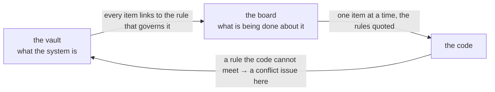

<br>

     

<h1 align="center">

claude-vault

</h1>

<p align="center">
  <b>A design vault your agent reads in full, and the workflow that builds your code from it.</b>
</p>

An Obsidian vault that holds your project's design — what it is, why it's shaped that way, and what you've decided — as a single source of truth that you and your Claude agent both read. And the workflow that turns it into code: a board of build items, each linked to the rule that governs it, built and checked by agents, and merged by you.

Your agent starts every session knowing nothing about the last one. You don't. That gap is why you re-explain the same architecture every week, why your agent keeps proposing the thing you rejected in July, and why your docs quietly go stale until they mislead you instead of helping. This closes it four ways: the design lives in files your agent reads in full before it advises you, every load-bearing decision is recorded next to the reasoning behind it, a guard script catches the countable kinds of drift so you never have to hunt for them by re-reading, and the build is tracked somewhere *other* than the design, so the design never fills up with plans that go stale.

It's plain Markdown, so it works in any editor — but it's built for [Obsidian](https://obsidian.md), which renders the `[[wikilinks]]`, Mermaid diagrams and callouts as intended. You'll also want [Claude Code](https://claude.com/claude-code), Node.js 18+ for the guard, and the [GitHub CLI](https://cli.github.com) signed in with the `project` scope.

## Setting it up

The guard fails on purpose until both of these are done — a vault that passes its own checks while nobody has said what it documents, or where its code lives, is a vault where every later note is guessing. Your agent is instructed never to guess a value for either.

**1. Fill in the four fields in `Overview/Project Charter.md`.** Your project's name, what it does in one sentence, who it's for, and the domain it lives in.

**2. Set up the build, and fill in `.claude/workflow.json`.**

- **Two repositories.** This one, for the design, and one for the code.
- **One GitHub Project** spanning both, with these fields:

  | Field | Kind | Values |
  |---|---|---|
  | Status | single select | Not Started · In Progress · Blocked on design · Done · Live · Canceled |
  | Finished by | single select | Agent · Person |
  | Rule | text | a link to the note and section on this repository's `main` that governs the item |
  | Priority | single select | whatever scale you like |

  Turn on two of the project's built-in workflows: *item closed → Done*, and *auto-add* for new issues in the code repository.
- **Two labels in this repository**, `conflict` and `deferred`. The issue templates in `.github/` use them.
- **Branch rules on the code repository:** only `main`, `milestone/…` and `issue/…` branches; squash merges into a milestone branch; a merge commit into `main`.
- **One instruction file in the code repository**, its `CLAUDE.md`, which is a tripwire rather than a rulebook:

  ```markdown
  # Stop — this repository is not where an agent starts

  This repository holds code and nothing else. Every rule it answers to is in the design
  vault, <link to this repository>, and every agent session starts there with `/sync`.

  If you were not handed a build item from the board by a session started in the vault,
  stop now and tell the person to start the session in the vault instead.
  ```
- **The code checkout as a second working directory**, in `.claude/settings.local.json` here (it is ignored by git, because the path is your machine's):

  ```json
  { "permissions": { "additionalDirectories": ["<path to your code checkout>"] } }
  ```
- **`.claude/workflow.json`**: the two repositories, the board's title, and the commands your code's gate runs. Leave `deployedToProduction` at `false` until the day you first deploy.

Then run the guard:

```bash
node "_meta/check-vault.mjs"
```

## How to use it

**Start every session with `/sync`.** Your agent reads every note in order, runs the guard, then reviews the board — what the build is stopped on, what is free to take, what needs you. Skip this and you get design advice from a blank slate, which is exactly how you end up talked into contradicting yourself.

**Talk it through in chat.** Conversation is the default; writing to the vault is the exception. Your agent proposes, it doesn't file.

**When you decide something, it gets written where it belongs.** Most decisions are a sentence in the note that owns that part of the design — those notes are as binding as anything else here. Only a decision the rest of the design leans on — one where changing it later would make data wrong or break other parts — also gets a decision record in `Decisions/`, with its context, its consequences and what you considered instead.

**Nothing gets accepted without you.** Every decision record your agent writes starts as `status: draft` and stays there until you rule on it. Drafts get no row in the index and can't be cited as settled. The guard lists them on every run, so nothing sits unread and hardens into a decision you never made.

**Plan a phase, then run it with `/milestone`.** A milestone is one step that makes one part of the system whole. You and your agent plan it in conversation, against the vault, and it becomes issues on the board — each linked to the rule that governs it, and only once you've approved them. Then `/milestone` runs it end to end without you:



- A **verifier** agent writes the checks for an issue from the rule, before anything is built.
- An **issue manager** agent builds the issue on its own branch, to those checks.
- A fresh verifier checks the result against the rule — never against what the builder says it did.
- A pass is squashed into the milestone branch as one commit. A failure is weighed — is finishing it worth what it will cost? — and goes back for another round, takes a cheaper way out, or comes to you.
- Where the vault is silent and the choice is reversible, the agent decides, writes it down, and carries on. Only an irreversible step waits for you.
- At the end, you get **one page**: the verdict, a few steps to check by hand, every number against its limit, and every choice the agents made that you should know about. **You merge into `main`.** A hook stops any agent from doing it.

**A rule the code cannot meet stops the work.** It becomes a *conflict* issue here, blocking the items that wait on it, until you rule — by editing a note or accepting a decision. The rules are absolute: where the code cannot meet them, the code changes, or you decide.

## How to keep your documentation true

This part transfers anywhere. `CONVENTIONS.md` and the guard enforce it here, but the reasoning holds for any docs you and an agent share.

### 1. Keep decisions and living notes strictly apart

Everything you write is one of two things, and it determines how you're allowed to change it:

|  | **A decision record** | **A living note** |
|---|---|---|
| Answers | *Why* a load-bearing choice was made | *What* the system is now |
| Changing it | Never — supersede it with a new one | Edit it, bump the date |
| Authority | binding | just as binding |

A decision records a moment, so it stays true forever. A living note describes the present, so correct it rather than appending to it. Blur the two and you get something that's neither reliable history nor an accurate present.

**Only load-bearing decisions get a record.** Every record restates part of a living note, so every record is a second copy of a fact. That copy earns its cost only when the fact holds other parts of the design together. A definition, a preference, or a rule only one note depends on is a sentence in that note.

When a living note and a decision disagree, either the note is stale or you changed something the record still holds. Both are defects — surface the collision, don't quietly pick a winner.

### 2. Write each fact once and link to it

A fact stored in two places gets corrected in one. The half-corrected version is the dangerous one: it carries the fix *and* the old copy side by side, so it looks updated and you trust it.

Your project's name, scope and audience live in the Charter and nowhere else. Do the same with anything that recurs — pick one home, link to it from everywhere else. When a change ripples, grep the term across every file and fix all of it in one pass.

### 3. Write each rule beside how it's carried out

A note that states a rule and leaves the mechanism unsaid invites the agent about to build it to invent one. So every rule has a **Mechanism** box directly under it: the software, the job, the module, and how it carries the rule out. The box is design, not a report on the code — where the code differs, the box is the target. Never split a subject into a "concepts" note and a "technical" note; that split is exactly what gives one fact two homes.

### 4. Don't keep anything transient

No handoffs, build plans, roadmaps, phase plans, to-do lists, session notes, progress snapshots, "current state" briefs, open-questions notes, parking lots or backlogs. Any filename, any folder.

Each one is accurate the day you write it and progressively false afterward, and nothing ever goes back to retire a line. You end up with a second source of truth that disagrees with the first — and gets read as current.

What is being built, what phase it's in and what's blocked belong on the board, where closing an item is the act that retires it. An open question stays in conversation until you settle it, and then only the answer gets written down. A choice you've deliberately put off is a decision record if the design leans on it, and a *deferred* issue — with what would reopen it — if it doesn't.

### 5. Never let a note describe its own maturity, or what it lacks

Don't write how complete something is, how new it is, or what it's missing. The test is mechanical: **a line guaranteed to need overwriting is drift by construction — and if nobody overwrites it, the drift shipped silently.**

"Not started", "still small", "as this grows", "at the time of writing", an initialization date, a to-do callout naming a gap — each describes one day rather than the subject. Write what is. A gap worth remembering is a deferred issue on the board.

### 6. Date anything that rots without being touched

Most drift comes from an edit. One kind comes from the calendar: API pricing, rate limits, quotas, platform policy, vendor behavior. Notes carrying those use `type: platform` and must have `verified:` and `sources:`. An undated platform claim is worse than none, because you'll trust it. The guard fails a platform note missing either field and warns you when a verification passes 90 days.

### 7. Keep diagrams in text

Use Mermaid in fenced code blocks, never pasted images. It renders for you and reads losslessly for your agent, which can't see inside a screenshot. The ban is on the content, not the extension — a drawing stored as JSON inside a Markdown file is still a drawing.

Same logic more broadly: the vault carries the verbal half of design. Token values, format requirements, voice specifications, pipeline stages — those belong here. The rendered artifact doesn't.

### 8. You decide; the record proves it was you

An agent proposing something and an agent recording it are different acts, and collapsing them is the failure this whole setup exists to prevent. A proposal written in the voice of settled record launders an opinion into permanence — the log says *decided*, and six months later you can't tell your own call from a suggestion you never ruled on.

So your agent drafts, you accept, and only what you accepted gets a row. The same holds on the board: nothing is opened without your approval, and a conflict or a deferral is closed only by you, because closing it is what says you ruled.

### 9. Make countable facts script-checkable, never eyeball-checkable

`_meta/check-vault.mjs` verifies decision numbering and status, that every accepted decision has an index row and is linked from a living note, that every wikilink resolves, the frontmatter schema, platform dating and staleness, folder structure against the manifest, the absence of images and transient files, maturity prose and to-do callouts, claims about what is built, links to issues or pull requests, unfilled fields in the Charter and the workflow file, and that every `§` citation points at a real section.

The rule that keeps it worth having: **if you ever hand-fix a countable fact, add a check for it in the same pass.** Anything a script can verify should never be verified by reading again.

What it can't do is read prose for meaning. Passing means the numbers agree — a contradiction between two sentences still needs you, or an agent that has read everything, which is the other half of `/sync`.

### 10. Keep build status out of the design, and the design out of the build

Whether something is *built* is a claim about code. A design note asserting it's done is repeating a claim it can't check, and a stale green checkmark retires work you still have to do. The other direction matters as much: a build item links to the rule that governs it and never quotes it, and a note never links to an item. The note carries the answer; the item carries the question.

## Making it your own

The conventions are opinionated on purpose, and they're yours to change — just edit `CONVENTIONS.md`, the guard and the skills together so the rules and their enforcement never disagree. The skills carry out the contract and never restate it, so a rule changes in one place. Four pieces are worth keeping whatever else you rework:

- **`CLAUDE.md`** — what makes your agent load full context instead of guessing from the shape of your question.
- **The draft-then-accept split** — what keeps your agent's reasoning out of your record.
- **The guard script** — what makes a rule real rather than aspirational.
- **The verifier that didn't build what it checks** — what makes a passing check mean something.

`.claude/skills/milestone/known-mistakes.md` starts with failure classes that hold for any codebase; add the ones your own code teaches you as you find them.

## Where to start

- [Project Charter](Overview/Project%20Charter.md) — what your vault is about. Fill this in first.
- [Home](Home.md) — the map of content
- [CONVENTIONS](CONVENTIONS.md) — the full authoring contract, and §10 for the build workflow
- [Vault manifest](_meta/manifest.md) — what exists, and the reading order
- [ADR Index](Decisions/_ADR%20Index.md) — the decision log
